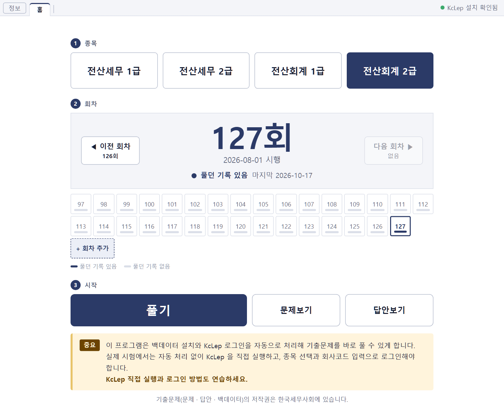

# 기출문제풀기 전산세무회계

전산세무 · 전산회계 기출문제 백데이터를 회차별로 KcLep 에 바로 설치해 풀 수 있게 하는 Windows 프로그램입니다.

## 하는 일

- 종목과 회차를 선택하고 [풀기] 를 클릭하면 그 회차 백데이터를 KcLep 에 설치하고 로그인까지 처리합니다.
- KcLep 이 이미 열려 있으면 닫기 전에 확인 창이 표시됩니다.
- 문제지 화면과 KcLep 창을 나란히 배치합니다.
- [문제보기] · [답안보기] 로 문제지와 확정답안을 바로 확인합니다.
- 회차 자료는 회차를 처음 열 때 다운로드하고, 회차 자료가 새로 바뀌면 다시 다운로드합니다.
- 목록에 없는 회차는 한국세무사회에서 다운로드한 기출문제 파일을 [회차 추가] 에 끌어다 놓아 추가합니다.

## 필요한 것

- Windows 10 (32비트 · 64비트) · Windows 11
- KcLep 교육용 프로그램
  - 한국세무사회 공식 사이트에서 다운로드해 설치합니다: https://license.kacta.or.kr
  - KcLep 이 설치되어 있지 않으면 프로그램 오른쪽 위에 [KcLep 미설치 · 다운로드] 가 표시되고, 클릭하면 위 사이트가 열립니다.

KcLep 이 관리자 권한으로 실행되므로, 이 프로그램을 실행할 때도 관리자 권한 확인 창이 표시됩니다.

## 설치

1. [최신 설치 파일 다운로드](https://github.com/program-going/gichulpulgi-kclep/releases/latest) 에서 `.exe` 파일을 다운로드합니다.
2. 다운로드한 파일을 실행하고 설치 화면의 안내대로 진행합니다.
   - 처음 실행할 때 'Windows의 PC 보호' 창이 나오면 [추가 정보] → [실행] 을 클릭합니다.
3. 바탕화면의 [기출문제풀기 전산세무회계] 를 실행합니다.

지난 버전은 [Releases](https://github.com/program-going/gichulpulgi-kclep/releases) 에 있습니다.

## 업데이트

새 버전이 있으면 프로그램을 실행할 때 안내 창이 표시됩니다.

[업데이트] 를 클릭하면 새 버전을 설치하고 프로그램이 다시 실행됩니다.

안내 창을 닫은 뒤에는 [정보] → [업데이트 확인] 으로 새 버전을 직접 확인할 수 있습니다.

## 실제 시험과 다른 점

이 프로그램은 백데이터 설치와 KcLep 로그인을 자동으로 처리합니다.

실제 시험에서는 KcLep 을 직접 실행하고, 종목 선택과 회사코드 입력으로 로그인해야 합니다.

KcLep 직접 실행과 로그인 방법도 따로 연습하세요.

## 문의

사용 중 궁금한 점이나 오류는 [Issues](https://github.com/program-going/gichulpulgi-kclep/issues) 에 글로 남겨 주세요.

글을 남기려면 GitHub 로그인이 필요합니다.

## 저작권

- 기출문제(문제 · 답안 · 백데이터)의 저작권은 한국세무사회에 있습니다.
- 프로그램: © 2026 program-going. All rights reserved.
